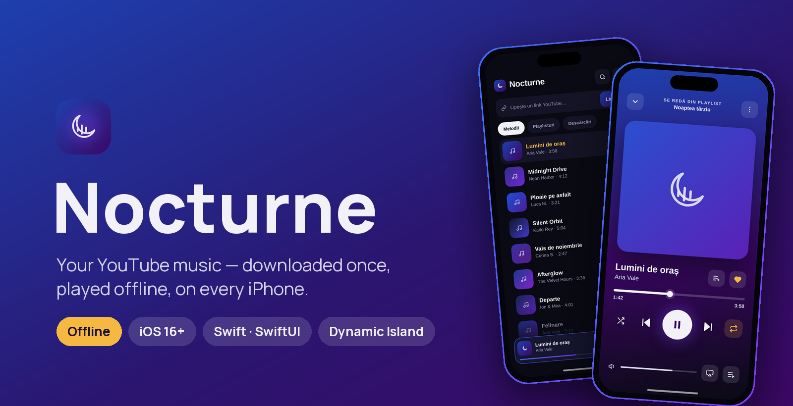
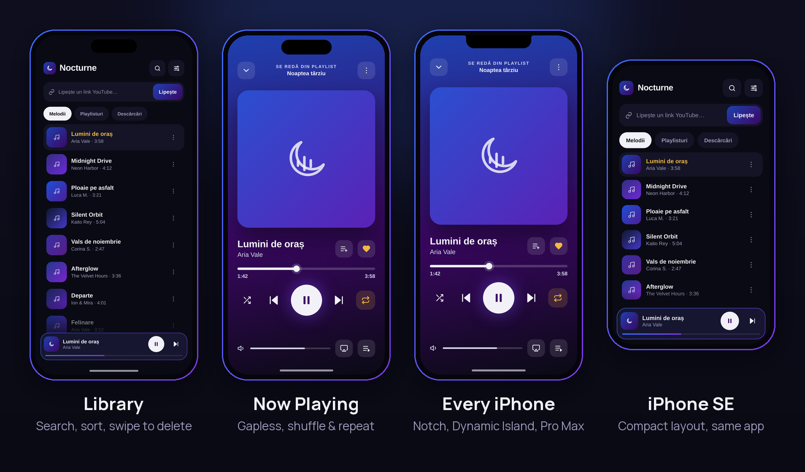
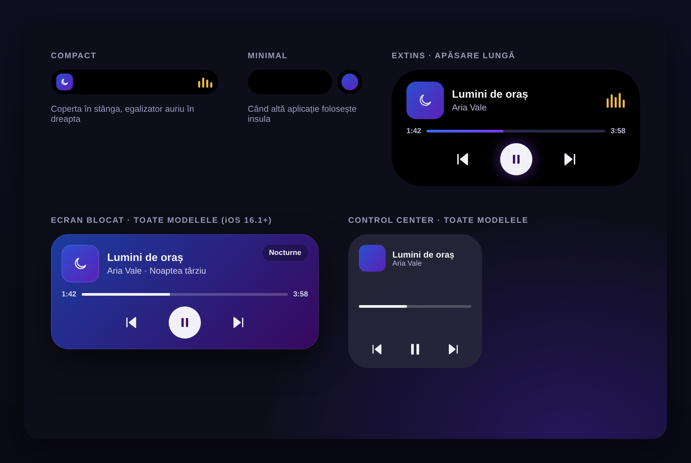

<div align="center">



<br>

<a href="https://github.com/cr37u/nocturne-ios/releases/latest"></a>
&nbsp;

&nbsp;

&nbsp;
<a href="https://github.com/cr37u/nocturne-ios/actions/workflows/ios.yml"></a>
&nbsp;
<a href="LICENSE"></a>

<br><br>

**Lipești un link YouTube. Nocturne descarcă audio o singură dată și îl redă offline,**<br>
**cu telefonul blocat, din Control Center, pe Dynamic Island sau cu AirPods. Fără cont, fără chei API, fără servere.**

<br>

<a href="https://github.com/cr37u/nocturne"></a>
&nbsp;
<a href="https://github.com/cr37u/nocturne-desktop"></a>

</div>

<br>

<p align="center">
  
</p>

## Ce face

<table>
<tr>
<td width="50%" valign="top">

### Adaugă orice de pe YouTube
Video-uri, playlisturi întregi (toate paginile) și YouTube Mix. Lipești linkul, folosești
**Share → Nocturne** din aplicația YouTube sau Safari, sau lași Nocturne să preia linkul
pe care tocmai l-ai copiat.

</td>
<td width="50%" valign="top">

### Descărcări rapide, în fundal
Cel mai bun flux audio m4a/AAC (se redă nativ, fără ffmpeg). Patru melodii în paralel,
bucăți de 10 MB, trei reîncercări, duplicatele sărite. Descărcările continuă după ce ieși
din aplicație.

</td>
</tr>
<tr>
<td width="50%" valign="top">

### Redare reală în fundal
Ecran blocat, Control Center, AirPods și Bluetooth, fără pauză între melodii, apeluri și Siri
tratate corect, pauză când scoți căștile. După repornire continuă exact de unde ai rămas.

</td>
<td width="50%" valign="top">

### Dynamic Island
Coperta și controalele apar în insulă și pe ecranul blocat, ca la orice player iOS.
Opțional, un card **Live Activity** în culorile Nocturne (Setări → Sistem).

</td>
</tr>
<tr>
<td width="50%" valign="top">

### Biblioteca ta, organizată
Căutare care ignoră majusculele și diacriticele („oras” găsește „oraș”, și chirilic), sortare,
swipe pentru ștergere, favorite, playlisturi și coadă reordonabilă. **Editează detaliile**
corectează un titlu peste tot deodată. Playlisturile importate rămân marcate <em>Din YouTube</em>.

</td>
<td width="50%" valign="top">

### Share → Nocturne
Din aplicația YouTube sau din Safari apeși **Share → Nocturne** și ajungi direct la
**Adaugă muzică** cu linkul completat. Nu mai copiezi nimic de mână.

</td>
</tr>
<tr>
<td width="50%" valign="top">

### Versuri sincronizate
„…” → **Versuri**: textul derulează odată cu melodia și linia curentă se aprinde. Atingi orice
linie ca să sari acolo. Versurile vin de pe [LRCLIB](https://lrclib.net) și rămân salvate
pentru ascultare offline.

</td>
<td width="50%" valign="top">

### Română · English · Русский
Schimbi limba live din **Setări → Limbă**, fără repornire. Live Activity o urmează.
Titlurile melodiilor sunt datele tale și nu se traduc niciodată.

</td>
</tr>
<tr>
<td width="50%" valign="top">

### Pe fiecare iPhone
Layout făcut pentru SE (buton Home), notch, Dynamic Island și Plus / Pro Max. Totul se
calculează din zonele sigure și lățimea ecranului, deci și modelele viitoare arată corect.

</td>
<td width="50%" valign="top">

### Fișierele sunt ale tale
Melodiile stau în **Fișiere → Pe iPhone → Nocturne → Music**, ca `.m4a` obișnuite.
Rămân după actualizări și le poți copia oriunde.

</td>
</tr>
</table>

<p align="center">
  
</p>

## Instalare

Nocturne nu e în App Store. Se instalează cu **[Sideloadly](https://sideloadly.io)** de pe Windows sau Mac,
cu Apple ID-ul tău gratuit.

1. Descarcă **`Nocturne-unsigned.ipa`** din [Releases](https://github.com/cr37u/nocturne-ios/releases/latest)
   sau din ultimul build reușit din [Actions](https://github.com/cr37u/nocturne-ios/actions/workflows/ios.yml) (artefactul *Nocturne-unsigned-ipa*).
2. Instalează **iTunes** și **iCloud** în varianta de pe site-ul Apple (**nu** din Microsoft Store), apoi **Sideloadly**.
3. Conectează iPhone-ul prin cablu, trage `.ipa` în Sideloadly, scrie Apple ID-ul și apasă **Start**.
   Lasă **nebifat** „Remove app extensions”, altfel pierzi Live Activity și Share.
4. Pe iPhone: **Setări → General → VPN și gestionare dispozitiv** → Apple ID-ul tău → **Ai încredere**,
   apoi **Setări → Confidențialitate și securitate → Mod dezvoltator → Activat**.

> [!IMPORTANT]
> Cu un Apple ID gratuit semnătura expiră după **7 zile**. Reinstalezi același `.ipa` din Sideloadly
> (sau activezi **Auto-refresh**) și aplicația se actualizează peste cea veche, **cu tot cu melodii și setări**.

> [!TIP]
> Cardul Live Activity e oprit implicit: iOS arată deja playerul pe ecranul blocat și în Dynamic Island.
> Îl pornești din **Setări → Sistem → Card Live Activity** dacă vrei și cardul Nocturne.

Interfața e în română, cu engleză și rusă la o atingere distanță.

<details>
<summary><b>Limitele unui Apple ID gratuit</b></summary>
<br>

- Maxim **3 aplicații** instalate simultan prin sideload.
- Maxim **10 App ID-uri pe săptămână**. Nocturne folosește **3**: aplicația, extensia Live Activity și extensia Share.
- Dacă bundle ID-ul `com.nocturne.player` e deja luat, schimbă `BASE_BUNDLE_ID` și `APP_GROUP_ID` în
  `project.yml` (de ex. `com.numele-tau.nocturne` / `group.com.numele-tau.nocturne`) și rulează din nou buildul.

</details>

## Sub capotă

| | |
|---|---|
| **UI** | Swift, SwiftUI, Manrope, MVVM (`ObservableObject`) |
| **Redare** | `AVQueuePlayer` (melodia următoare preîncărcată), `MPNowPlayingInfoCenter`, `MPRemoteCommandCenter` |
| **Extragere** | [YouTubeKit](https://github.com/alexeichhorn/YouTubeKit) în spatele protocolului `StreamResolver` |
| **Playlisturi** | InnerTube `browse` / `next` + oEmbed, limba metadatelor fixă (`en`) |
| **Descărcări** | `URLSession` în fundal, cereri pe intervale, 4 în paralel |
| **Versuri** | [LRCLIB](https://lrclib.net) (LRC sincronizat), salvate pe telefon |
| **Sistem** | ActivityKit (Live Activity opțională), App Intents, Share Extension |
| **Stocare** | GRDB (SQLite) cu migrări versionate; audio în `Documents/Music/Nocturne` |

<details>
<summary><b>Cum funcționează redarea</b></summary>
<br>

- `AVAudioSession` în categoria `.playback` și `UIBackgroundModes = audio`: muzica merge cu ecranul stins.
- `AVQueuePlayer` ține mereu melodia curentă și pe următoarea, așa că trecerea se face fără pauză, și în fundal.
- Întreruperile (apeluri, Siri, alte aplicații) pun pauză și reiau când sistemul permite.
  Deconectarea căștilor pune pauză.
- Coada, poziția, amestecarea și repetarea se salvează continuu în baza de date și se restaurează la pornire.
- Live Activity (dacă e pornită din Setări) pornește odată cu redarea și se actualizează la schimbarea melodiei, play/pauză și derulare.
  Bara de progres avansează singură, fără actualizări în plus.

</details>

<details>
<summary><b>Structura proiectului</b></summary>
<br>

```
App/
├── Data/        GRDB: modele, migrări, bibliotecă
├── YouTube/     StreamResolver (YouTubeKit), catalog de playlisturi, erori
├── Download/    descărcări în fundal, copertă
├── Playback/    player, ecran blocat, Live Activity
├── Lyrics/      LRCLIB + parser LRC
└── UI/          Bibliotecă, Se redă acum, Adaugă muzică, Playlisturi, Setări, componente
Shared/          temă, iconițe, traduceri, intents (aplicație + extensii)
Widgets/         Live Activity și Dynamic Island (opțional)
ShareExtension/  Share → Nocturne
```

</details>

## Build din sursă

Nu ai nevoie de Mac. Fiecare push pe `main` construiește `.ipa` pe GitHub Actions, pe un runner macOS gratuit
pentru repo-uri publice. Un tag `v*` îl atașează și la un Release.

```bash
git tag v1.0.0 && git push --tags     # build + GitHub Release cu Nocturne-unsigned.ipa
```

Al doilea job rulează testele și face capturi pe **iPhone SE (3rd gen), iPhone 14, iPhone 15 Pro și iPhone 16 Pro Max**
(artefactul *screenshots*), ca să verifici layoutul pe fiecare model.

Pe un Mac:

```bash
brew install xcodegen
xcodegen generate
open Nocturne.xcodeproj
```

<details>
<summary><b>Actualizarea extractorului YouTube</b></summary>
<br>

Când YouTube schimbă ceva și descărcările nu mai merg, de obicei ajută o versiune nouă de YouTubeKit.
Versiunea e setată în `project.yml`:

```yaml
packages:
  YouTubeKit:
    url: https://github.com/alexeichhorn/YouTubeKit
    from: "0.2.0"
```

Faci push și buildul ia cea mai nouă versiune compatibilă. Versiunea folosită apare în **Setări → Despre**.
Poți înlocui și tot extractorul implementând alt `StreamResolver`.

</details>

<details>
<summary><b>Traduceri, font și iconiță</b></summary>
<br>

- `Shared/Resources/Localizable.xcstrings` e generat din string-urile aplicației Android:
  `python tools/make_strings.py ../app/src/main/res`
- `tools/make_fonts.py` face greutățile statice Manrope din fontul variabil.
- `tools/make_icon.py` desenează iconița în toate mărimile; `tools/make_readme_images.py` face imaginile din README.

</details>

Lista completă de teste pe telefon e în [docs/TESTING.md](docs/TESTING.md).

## Disclaimer

Nocturne nu e afiliat cu YouTube sau Google. Descarcă doar conținut pe care ai dreptul să-l descarci
și respectă Termenii YouTube și legile drepturilor de autor din țara ta.

## Licență

Publicat sub [GNU General Public License v3.0](LICENSE).
Nocturne folosește [YouTubeKit](https://github.com/alexeichhorn/YouTubeKit) (MIT), [GRDB](https://github.com/groue/GRDB.swift) (MIT)
și fontul [Manrope](https://github.com/googlefonts/manrope) (SIL OFL 1.1).
