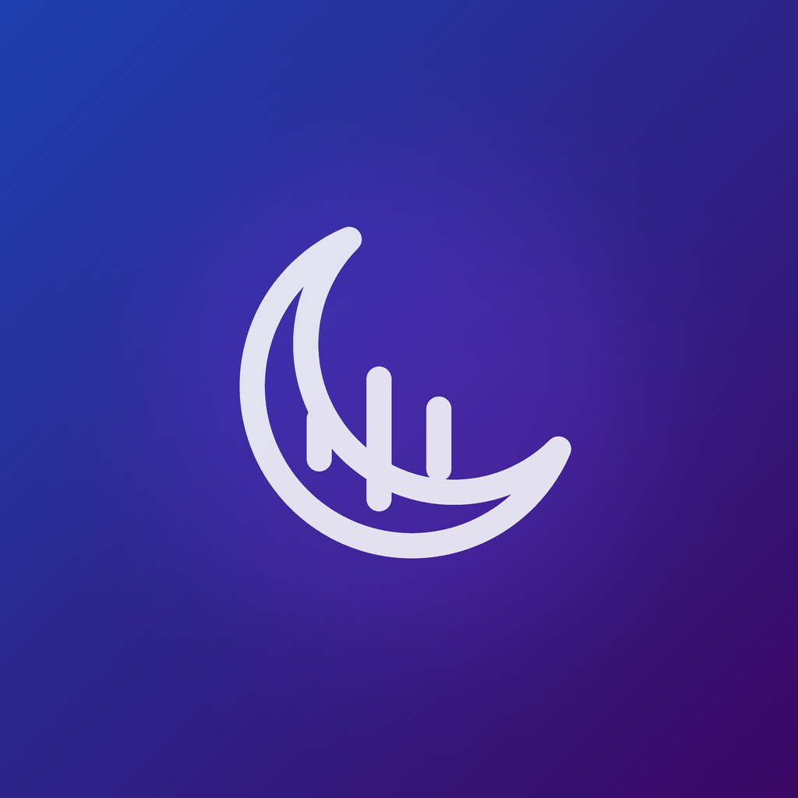

<div align="center">



# Nocturne pentru iPhone

**Lipești un link YouTube, Nocturne descarcă audio o singură dată și îl redă offline:**<br>
**cu ecranul blocat, din Control Center, cu AirPods, pe Dynamic Island și în widgeturi.**

Versiunea nativă iOS (Swift + SwiftUI) a aplicației Android [Nocturne](https://github.com/cr37u/nocturne).

</div>

---

## Ce face

- **Adaugă din link**: video, playlist (toate paginile), YouTube Mix, `youtu.be`, `music.youtube.com`, Shorts. Buton **Lipește**, detectare automată a linkului din clipboard la deschidere și **Share → Nocturne** din aplicația YouTube sau din Safari.
- **Descărcare rapidă**: cel mai bun flux audio m4a/AAC (se redă nativ, fără ffmpeg), 4 melodii în paralel, 3 reîncercări, progres și viteză pe fiecare melodie plus progres total. Duplicatele sunt sărite după ID-ul video YouTube. Descărcările continuă și când aplicația e în fundal.
- **Totul offline** după descărcare. Fișierele sunt în **Fișiere → Pe iPhone → Nocturne → Music** și rămân după actualizări.
- **Player complet**: trece automat la melodia următoare (fără pauză între melodii), și cu telefonul blocat. Are amestecare, repetare (oprită / toate / una), volum, AirPlay, favorite, adăugare în playlist, coadă reordonabilă și **versuri sincronizate** (LRCLIB, salvate pentru offline). Glisezi pe copertă ca să schimbi melodia. La repornire, continuă de unde ai rămas.
- **Ecran blocat, Control Center, AirPods/Bluetooth**, apeluri și Siri tratate corect. Muzica se oprește când scoți căștile.
- **Dynamic Island + Live Activity**: compact, minimal și extins pe modelele cu insulă; cardul de pe ecranul blocat apare pe toate modelele, inclusiv SE și cele cu notch.
- **Widgeturi**: mic, mediu, mare și pe ecranul blocat. Butoanele sunt interactive pe iOS 17+.
- **Română / English / Русский**, schimbare live din Setări. Titlurile melodiilor nu se traduc niciodată. **Editează detaliile** corectează titlul sau artistul peste tot.
- Layout adaptat pentru **iPhone SE, notch, Dynamic Island și Pro Max**, după dimensiunile ecranului, fără valori fixe.

---

## Cum obții primul `.ipa` (fără Mac)

`.ipa` se construiește gratuit pe GitHub Actions, pe un runner macOS (minutele macOS sunt gratuite pentru repo-urile **publice**).

1. **Creează repo-ul** pe GitHub: <https://github.com/new>, nume `nocturne-ios`, **Public**, fără README.
2. **Urcă proiectul** din folderul `ios-nocturne`:
   ```powershell
   cd D:\Nocturne\ios-nocturne
   git remote add origin https://github.com/cr37u/nocturne-ios.git
   git push -u origin main
   ```
3. Pe GitHub deschide **Actions → iOS**. Rulează automat la fiecare push, cu două joburi:
   - **Build unsigned IPA**: generează proiectul cu XcodeGen, rezolvă pachetele (YouTubeKit, GRDB), face `xcodebuild archive` și creează `Nocturne-unsigned.ipa`.
   - **Tests & screenshots**: rulează testele și face capturi ale ecranelor pe iPhone SE (3rd gen), iPhone 14, iPhone 15 Pro și iPhone 16 Pro Max.
4. Când jobul e verde: intră în run → **Artifacts** → descarcă **Nocturne-unsigned-ipa** (e un `.zip` care conține `Nocturne-unsigned.ipa`) și **screenshots** (capturile pe fiecare model).
5. **Release** (opțional): `git tag v1.0.0 && git push --tags` atașează `.ipa` la un GitHub Release.

> Dacă un build eșuează: descarcă artefactul **archive-log** (sau copiază erorile din pasul „Show compiler errors”) și trimite-mi-l.

---

## Instalare cu Sideloadly (Windows, Apple ID gratuit)

### O singură dată
1. Instalează **iTunes** și **iCloud** în varianta descărcată direct de la Apple (**nu** din Microsoft Store). Linkurile exacte sunt pe pagina de descărcare <https://sideloadly.io>, secțiunea *Windows requirements*.
2. Instalează **Sideloadly**: <https://sideloadly.io>.
3. Conectează iPhone-ul prin cablu, deblochează-l și apasă **Ai încredere** pe telefon.

### Instalarea
1. Deschide Sideloadly, trage `Nocturne-unsigned.ipa` în fereastră.
2. La **Apple account** scrie Apple ID-ul tău (recomandat: un Apple ID secundar).
3. În **Advanced options** lasă bifat **Signing mode: Apple ID Sideload** și **nu** bifa „Remove app extensions”. Extensiile sunt widgeturile, Live Activity și Share.
4. Apasă **Start**, introdu parola (și codul 2FA).
5. Pe iPhone:
   - **Setări → General → VPN și gestionare dispozitiv** → profilul cu Apple ID-ul tău → **Ai încredere**.
   - iOS 16+: **Setări → Confidențialitate și securitate → Mod dezvoltator → Activat**, apoi repornește telefonul și confirmă.

### Reîmprospătarea la fiecare 7 zile
Cu un Apple ID gratuit, semnătura expiră după **7 zile**. După aceea aplicația nu mai pornește, dar **datele și melodiile rămân**.
- Manual: deschizi Sideloadly și reinstalezi același `.ipa` cu același Apple ID. Aplicația se actualizează peste cea existentă.
- Automat: bifează **Auto-refresh** în Sideloadly. PC-ul trebuie să fie pornit, cu Sideloadly deschis, iar iPhone-ul pe același Wi-Fi (sincronizarea Wi-Fi activată o dată din iTunes).

### Limitele unui Apple ID gratuit
- Maxim **3 aplicații** instalate simultan prin sideload.
- Maxim **10 App ID-uri pe săptămână**. Nocturne folosește **3** (aplicația + widgeturi + Share).
- Dacă bundle ID-ul `com.nocturne.player` e deja folosit de altcineva, schimbă `BASE_BUNDLE_ID` și `APP_GROUP_ID` în `project.yml` (de ex. `com.florin.nocturne` / `group.com.florin.nocturne`), apoi fă push din nou.

### App Groups, widgeturi și Live Activities sub Sideloadly
- Aplicația, widgeturile, Live Activity și extensia Share împart date printr-un **App Group** (`group.com.nocturne.player`). CI-ul pune această permisiune în `.ipa`, iar Sideloadly o preia când semnează.
- Unele combinații Sideloadly / Apple ID gratuit **nu păstrează** App Group-ul. Verifici în **Setări → Sistem → Grup de aplicații**:
  - **Activ**: totul funcționează.
  - **Indisponibil**: aplicația merge normal (descărcare, redare, ecran blocat, Control Center, AirPods, Dynamic Island). Widgeturile arată „Deschide Nocturne”, iar Share → Nocturne deschide aplicația direct cu linkul.
- **Live Activities** nu au nevoie de permisiuni speciale. Le activezi din **Setări iOS → Nocturne → Live Activities**. Pornesc când dai Play din aplicație.
- Butoanele din widgeturi și din Live Activity sunt interactive pe **iOS 17+**. Pe iOS 16 o atingere deschide aplicația.

---

## Lista de test

- [ ] Lipește un link de **playlist** → apare „PLAYLIST DETECTAT” cu numărul de melodii, durata și câte sunt deja în bibliotecă → **Descarcă N melodii noi**.
- [ ] În **Descărcări**: procent, bară, MB/s; stări *Gata* / *Eșuat* (+ *Reîncearcă*) / *În așteptare*; **Pauză tot** / **Reia tot**.
- [ ] Ieși din aplicație în timpul descărcării → descărcarea continuă.
- [ ] Playlistul apare în **Playlisturi** cu eticheta **Din YouTube**.
- [ ] Redă o melodie → **blochează telefonul** → la final trece singur la următoarea.
- [ ] **Ecran blocat** și **Control Center**: titlu, artist, copertă, timp, play/pauză, următoarea, anterioara, derulare.
- [ ] **AirPods**: apăsare = play/pauză, dublă = următoarea, triplă = anterioara; scoți o cască sau deconectezi → pauză.
- [ ] Apel telefonic sau Siri → pauză, apoi reia.
- [ ] **Dynamic Island** (14 Pro și mai noi): compact (copertă + egalizator auriu), minimal (cu altă aplicație activă), extins la apăsare lungă (controale).
- [ ] **Live Activity pe ecranul blocat** pe toate modelele (inclusiv SE și notch).
- [ ] **Widgeturi**: mic / mediu / mare / ecran blocat; butoanele (iOS 17+), „URMEAZĂ”, repetare aurie când e activă, „Adaugă link”.
- [ ] **Setări → Limbă**: Română → English → Русский, live, fără repornire; widgeturile și Live Activity urmează limba.
- [ ] Titlurile melodiilor **rămân neschimbate** după schimbarea limbii.
- [ ] **Editează detaliile** (meniul ⋮ sau „…” în Se redă acum) → titlul nou apare peste tot: listă, Se redă acum, ecran blocat, Control Center, widget, Live Activity.
- [ ] **Versuri**: „…” → Versuri; linia curentă evidențiată, atingi o linie → sare acolo; merg și offline după prima încărcare.
- [ ] **Fișiere → Pe iPhone → Nocturne → Music**: melodiile `.m4a` sunt vizibile.
- [ ] Închide complet aplicația și redeschide → ultima melodie, poziția și coada sunt restaurate.
- [ ] Layout corect pe **SE** (buton Home), **notch**, **Dynamic Island** și **Pro Max**. Compară cu capturile din artefactul **screenshots** și cu planșele din `design/ios`.

---

## Pentru dezvoltare

| | |
|---|---|
| Proiect | `project.yml` (XcodeGen). `.xcodeproj` nu e în git; CI rulează `xcodegen generate`. |
| UI | SwiftUI, iOS 16.0+, MVVM (`ObservableObject`). |
| Extragere YouTube | [YouTubeKit](https://github.com/alexeichhorn/YouTubeKit) în spatele protocolului `StreamResolver` (`App/YouTube/StreamResolver.swift`). Versiunea apare în Setări → Despre. |
| Playlisturi / titluri | `YouTubeCatalog` (InnerTube `browse`/`next` + oEmbed). Limba metadatelor e fixă (`en`/`US`), independentă de limba aplicației. |
| Redare | `AVQueuePlayer` (melodia curentă + următoarea preîncărcată), `MPNowPlayingInfoCenter`, `MPRemoteCommandCenter`. |
| Bază de date | GRDB (SQLite) cu migrări versionate (`App/Data/AppDatabase.swift`). |
| Descărcări | `URLSession` în fundal, bucăți de 10 MB, 4 în paralel, 3 încercări. |
| Traduceri | `Shared/Resources/Localizable.xcstrings`, generat din string-urile Android cu `python tools/make_strings.py ../app/src/main/res`. |
| Font / icon | `tools/make_fonts.py` (Manrope static din fontul variabil), `tools/make_icon.py`. |

**Când YouTube schimbă ceva** și descărcările nu mai merg: crește versiunea YouTubeKit în `project.yml` (`packages → YouTubeKit`), fă push, iar CI construiește un `.ipa` nou. Alternativ, implementează alt `StreamResolver` și schimbă `DownloadManager.resolver`.

### Limitări cunoscute
- Live Activity nu poate rula animații continue, așa că egalizatorul din insulă e static (înalt când rulează, jos în pauză). Bara de progres și timpul avansează singure.
- O Live Activity pornește doar când redarea începe cu aplicația deschisă (regulă iOS). Ecranul blocat are oricum controalele standard.
- Melodiile încă „În așteptare” încep când aplicația e deschisă. Cele deja pornite continuă în fundal.

---

Font: [Manrope](https://github.com/sharanda/manrope) (SIL Open Font License). Licență: GPL-3.0, la fel ca aplicația Android.
